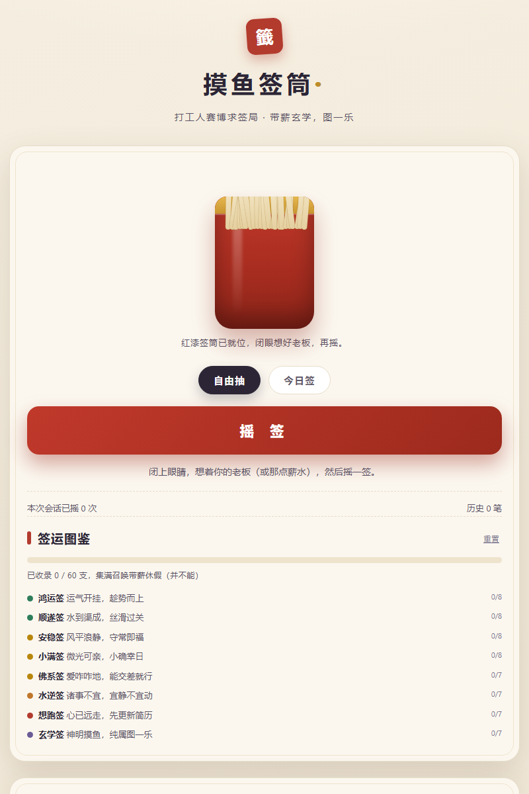

# 摸鱼签筒

> 不知道今天该不该摸鱼？摇一签，让签替你背锅。

[](./LICENSE) [](./assets/moyu-qiantong.html) [](./SKILL.md)

**🔗 [在线体验 →](https://tomatoribs.github.io/moyu-qiantong/)**（点开就玩 · 免安装 · 免注册）



一个 57 KB 的单文件 HTML，断网也能玩，手机直接适配——在线链接挂了也不要紧，clone 下来双击 `assets/moyu-qiantong.html` 照样能摇。

今天要不要摸鱼？你问了自己八遍，还是没答案。
该不该跑路？想了一整个下午，活一点没干。
决策的成本，早就超过了决策本身。

闭上眼睛，想着你的老板（或那点薪水），然后摇一签——让 60 支签替你做主。

**60 支签 · 8 档运势 · 双模式 · 集签图鉴 · 0 上传**

## 你会摇到什么

| 档位 | 支数 |
|---|---|
| 鸿运签 | 8 |
| 顺遂签 | 8 |
| 安稳签 | 8 |
| 小满签 | 8 |
| 佛系签 | 7 |
| 水逆签 | 7 |
| 想跑签 | 7 |
| 玄学签 | 7 |

合计 60 支，无一重复。从「运气开挂，趁势而上」到「心已远走，先更新简历」，中间夹着几支说不清吉凶的怪签。一天一签的话，集满一轮刚好两个多月——页面原话：「已收录 0 / 60 支，集满召唤带薪休假（并不能）。」

## 签筒里有什么

- 🏮 **摇签**——红漆签筒左右摇晃，飞出一签，弹出签文卡片
- 🎴 **60 支原创签**——每支都有独立签诗、解签、建议，和一件配套摸鱼工具
- 🔀 **双模式**——自由抽（随机，想快就多摇）/ 今日签（拼上当天日期算出固定结果，同一浏览器同一天摇出来都一样）
- 📖 **集签图鉴**——摇过的签点亮左栏图鉴与进度条，进度存本机
- 🖼 **存图转发**——摇完点一下，生成 750×1420 竖版签文海报（Canvas 本地绘制），带签号
- 🔒 **0 上传**——记录只存本机且有上限，不联网

## 效果示例

以下为「鸿运签」中真实的一支，摘自签库原文：

```text
┌────────────────────────────────┐
│  鸿运签 · 前程似锦              │
│                                │
│  签诗：                         │
│  春风得意马蹄疾，               │
│  今日诸事尽相宜。               │
│                                │
│  解签：今天运气开挂，提案一次过、│
│  bug 自动消，连外卖都提前到。   │
│                                │
│  建议：趁势把最难的任务推掉一半 │
│  进度，其余时间理直气壮喘气。   │
│                                │
│  配套工具：摸鱼计时器           │
└────────────────────────────────┘
```

## 三个问题

- **要联网吗？** 不用，双击就能摇，断网照常。
- **我的记录会被发出去吗？** 不会，全部存本机；分享出去的只有你主动保存的海报。
- **准吗？** 与任何宗教、命理、占卜无关——它的任务不是预测，是把「选哪个」这一分钟还给你。

## 怎么用

1. 点在线体验链接，或双击 `assets/moyu-qiantong.html`（手机可直接打开）。
2. 摇签——可自由抽，也可切「今日签」看今天的固定结果。
3. 存竖版海报发给朋友，或慢慢集齐 60 支签的图鉴。

## 隐私

全部计算与记录都在浏览器本地完成，不联网、不上传。记录只存本机且有上限；清空记录会删掉这个浏览器里保存的全部抽签历史。

## 工位生存指南 · 六件套

| 现在的状况 | 玩哪个 | 花多久 |
|---|---|---|
| 什么也不想干 | **摸鱼签筒（你在这）** | 摇一签 |
| 想知道到底有多想走 | [跑路指数测试](https://github.com/TomatoRibs/want-to-quit-index) | 6 分钟 |
| 想知道消耗的源头是谁 | [上司图鉴](https://github.com/TomatoRibs/shangsi-tujian) | 3 分钟 |
| 想给某个同事开庭 | [同事判刑书](https://github.com/TomatoRibs/workplace-verdict) | 3 分钟 |
| 只想先给环境做个体检 | [工位窒息指数](https://github.com/TomatoRibs/workplace-suffocation-index) | 30 秒 |
| 下午有一场会 | [车祸大会 Bingo](https://github.com/TomatoRibs/huoche-dahui-bingo) | 一场会 |

## 可二创

60 支签全部在 `assets/moyu-qiantong.html` 源码的 SIGNS 数组里——签诗、解签、建议、配套工具一处改完，TIERS 换档位名，就是「你们部门的签筒」。

## 为什么做这个

「要不要摸鱼」「该不该跑路」这类问题，问谁都不合适，问自己又没答案。签筒能替你做的唯一一件事，是把「选哪个」这一分钟还给你。

## 装成 WorkBuddy 技能（可选）

```bash
bash scripts/install_local.sh .
```

WorkBuddy 是一个本地 AI 助手；装成技能后，一句话触发：「做一个带双模式和集签图鉴的摸鱼签筒网页」。

## 免责声明

它是图一乐的随机玩具。60 支签文为原创文学创作，**与任何宗教、命理、占卜无关**，不提供运势预测、职业建议或人生决策建议，也非标准化心理量表，未做信效度检验。签文是写给「自己乐」的，别拿去套在具体的人身上。

## 作者 · 许可证

番茄排骨 · [MIT](./LICENSE)

摇到好签的话，回来点个 Star 还个愿。

> 签上说今天宜摸鱼，那就不许有负罪感。
